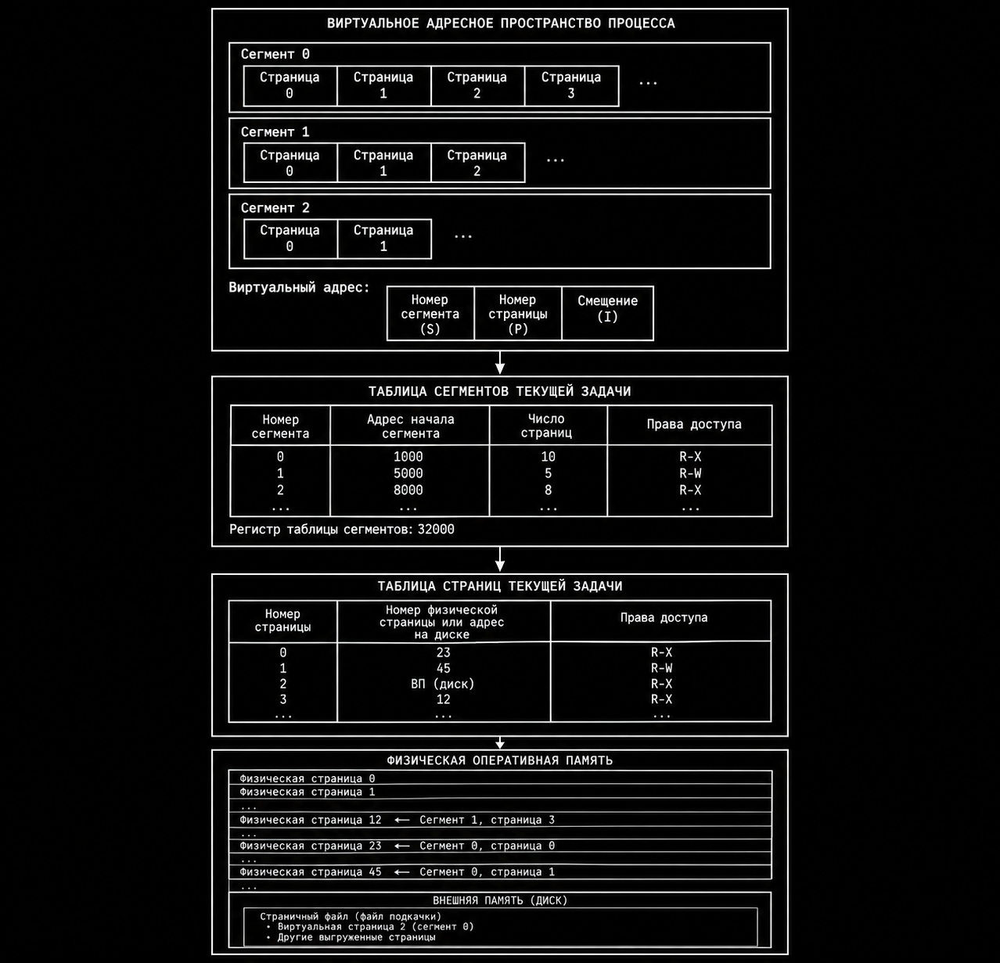

# Конспект

## 1. Введение. Роль памяти в компьютерной системе

Память — один из важнейших компонентов компьютерной системы. Она отвечает за хранение данных и приложений на временной или постоянной основе. Все компьютеры нуждаются в месте для временного хранения информации во время обработки других данных.

В цифровых компьютерах хранение информации организовано на двух уровнях:
- **Первичная память** — полупроводниковые чипы ОЗУ (RAM) и ПЗУ (ROM);
- **Внешняя память** — устройства для хранения больших объёмов информации (жёсткие диски, ленты, оптические диски и т.д.).

---

## 2. Иерархическая организация памяти

Современные ЭВМ имеют **3-уровневую иерархическую организацию** запоминающих устройств (ЗУ), отличающихся средним временем доступа и стоимостью хранения данных:

| Уровень | Тип памяти | Время доступа | Стоимость | Ёмкость |
|---------|-----------|---------------|-----------|---------|
| Верхний | Кэш-память | Минимальное | Максимальная | Минимальная |
| Средний | Основная (первичная) память | Среднее | Средняя | Средняя |
| Нижний | Внешняя (вторичная) память | Максимальное | Минимальная | Максимальная |

**Принцип работы:**
- ЦП может напрямую обращаться к кэш-памяти;
- Для обращения к программам и данным во внешней памяти их необходимо сначала переписать в основную память;
- При продвижении вниз по иерархии: время доступа увеличивается, скорость доступа падает, стоимость на бит уменьшается, ёмкость растёт.

---

## 3. Функции ОС по управлению памятью

Память — важнейший ресурс, требующий тщательного управления со стороны мультипрограммной ОС. Распределению подлежит вся оперативная память, незанятая ОС.

**Основные функции ОС:**
1. Отслеживание свободной и занятой памяти;
2. Выделение памяти процессам и освобождение при завершении;
3. Вытеснение процессов из ОП на диск при нехватке места и возвращение их обратно;
4. Настройка адресов программы на конкретную область физической памяти;
5. **Защита памяти** — запрет процессу читать/записывать данные из памяти другого процесса (реализуется программно-аппаратно).

---

## 4. Организация памяти

### 4.1. Структура памяти ЭВМ

Память состоит из двоичных запоминающих элементов — **битов**.
- В ранних ЭВМ использовались одно- и двухбайтовые ячейки (полуслова);
- В современных ЭВМ — ячейки из 4 последовательных байтов (**слово**);
- В каждую ячейку может быть записано только одно слово или одна команда.

**Разбиение памяти на слова (для 64-разрядного процессора):**
- Байт 0–7;
- Полуслово = 2 байта;
- Слово = 4 байта;
- Двойное слово = 8 байт.

### 4.2. Классификация памяти

**По типу носителя:**
- **Электронные схемы:**
  - ПЗУ (ROM) — энергонезависимая;
  - ОЗУ (RAM) — энергозависимая;
  - Кэш-память.
- **Накопители информации:**
  - Магнитные диски (гибкие, жёсткие);
  - Магнитные ленты;
  - Оптические диски (CD, DVD);
  - Магнитооптические диски.

**По энергозависимости:**
- **Энергонезависимая** (ПЗУ, Flash, CMOS, BIOS) — хранит информацию постоянно;
- **Энергозависимая** (ОЗУ) — хранит информацию, пока подводится электроэнергия; при прерывании питания содержимое исчезает.

### 4.3. Оперативная память (RAM)

- Работает в пределах компьютерной системы;
- Отвечает за временное хранение данных и их оперативную доступность для процессора;
- Информация загружается с жёсткого диска (ОС, приложения);
- При выключении системы ОЗУ теряет всю информацию.

**Виды ОЗУ:**
- **Статическое (SRAM)** — массивы триггеров;
- **Динамическое (DRAM)** — массивы конденсаторов.

**Основная память:**
- Стандартная (непосредственно адресуемая) — адреса от 0 до 1024 Кб;
- Расширенная — адреса 1024 Кб и выше (доступ через драйверы XMM).

### 4.4. Постоянное запоминающее устройство (ROM)

- Активно независимо от того, включена система или выключена;
- Постоянная энергонезависимая память;
- Данные не могут быть изменены;
- Интегрированная микросхема, запрограммированная важными данными;
- Пример: **BIOS** (Basic Input/Output System) материнской платы.

**BIOS:**
- Встроенное ПО, доступное без обращения к диску;
- Совокупность программ для автоматического тестирования устройств после включения питания и загрузки ОС в ОП;
- Записывается заводом-изготовителем;
- Содержит: программу самотестирования, драйверы некоторых устройств, программу загрузки ОС.

### 4.5. Кэш-память

- Высокоскоростная память, буфер между ОП и микропроцессором;
- Хранит копии наиболее часто используемых участков оперативной памяти;
- Располагается на центральном процессоре.

**Виды кэш-памяти по принципу записи:**
- **С обратной записью** — результаты фиксируются в кэш, затем в ОЗУ;
- **Со сквозной записью** — результаты одновременно фиксируются и в кэш, и в ОЗУ.

**Кэш-попадание** — запись с нужным идентификатором найдена в кэше.
**Кэш-промах** — запись не найдена, данные читаются из основной памяти.
**Коэффициент попаданий** — процент обращений, когда результат найден в кэше.

**Уровни кэш-памяти:**
- **L1** — встроенная в процессор, первого уровня;
- **L2** — второго уровня, обычно на одном кристалле с процессором;
- **L3** — третьего уровня (в современных процессорах).

---

## 5. Стратегии управления памятью

ОС постоянно решает задачу: **когда, куда и за счёт кого** ввести в ОП процесс и данные.

**Три стратегии управления ОП:**

1. **Стратегия выборки (вталкивания)** — определяет, когда разместить в ОП очередной блок программы или данных:
   - Выборка по запросу (требованию);
   - Упреждающая выборка (наиболее употребимая).

2. **Стратегия размещения** — определяет, куда помещать поступающую программу:
   - «Первый подходящий» участок (эффективность по времени);
   - «Наиболее подходящий» участок (эффективность по объёму);
   - «Наименее подходящий» участок.

3. **Стратегия замещения (выталкивания)** — определяет, какой блок вытолкнуть из ОП:
   - Выталкивание случайной страницы;
   - FIFO (First In First Out);
   - LRU (Least Recently Used) — дольше всего не использовавшаяся;
   - LFU (Least Frequently Used) — реже всего используемая;
   - NUR (Not Used Recently).

---

## 6. Виды организации реальной памяти

Существуют 4 вида организации реальной памяти:

1. **Однопрограммная организация** с выделением непрерывной области одному пользователю;
2. **Мультипрограммная организация с фиксированными разделами**;
3. **Мультипрограммная организация с динамическими разделами**;
4. **Перемещаемые разделы**.

### 6.1. Однопрограммная организация

- **Достоинства:** простота защиты ОП (пара регистров, определяющих границы доступа);
- **Недостатки:** простаивает ЦП, ОП и устройства ввода/вывода; неэффективное использование ЭВМ.

### 6.2. Мультипрограммная организация с фиксированными разделами

- ОП статически разбивается на ряд разделов фиксированного размера;
- В каждом разделе может выполняться одно задание.

**Достоинства:** большая загрузка ЦП, повышение пропускной способности.
**Недостатки:**
- Внешняя фрагментация — недостаточность разделов для больших программ;
- Внутренняя фрагментация — неиспользованная память разделена на несвязные участки.

### 6.3. Мультипрограммная организация с динамическими разделами

- Память не делится заранее;
- Каждой новой задаче выделяется необходимая память;
- После завершения задачи память освобождается.

**Достоинства:** повышается уровень мультипрограммирования, исчезает внешняя фрагментация.
**Недостатки:** внутренняя фрагментация.

### 6.4. Перемещаемые разделы

- Способ борьбы с фрагментацией — перемещение всех занятых участков в сторону младших или старших адресов;
- Свободная память образует единую свободную область;
- **Сжатие** — копирование содержимого разделов из одного места в другое с корректировкой таблиц.

---

## 7. Концепция виртуальной памяти

### 7.1. Определение

**Виртуальная память** — основная память процесса, адресное пространство которого соответствует диапазону непосредственной адресации системы команд ЭВМ и обычно не совпадает с объёмом реальной памяти.

**Виртуальный ресурс** — ресурс, который пользователю или программе представляется обладающим свойствами, которыми он в действительности не обладает.

### 7.2. Цели виртуальной памяти

1. Обеспечить возможность создания и выполнения программ максимально допустимого размера;
2. Облегчить жизнь программиста, сняв проблемы ограниченного объёма РОП;
3. Устранить временную фрагментацию, максимально эффективно используя ОП.

### 7.3. Суть концепции

Адресное пространство (АП) процесса отделяется от адресов реальной оперативной памяти (РОП) и по необходимости динамически и по частям отображается в реальную память.

**В ОС с реальной ОП:** привязка АП к реальным адресам осуществляется статически до выполнения программы на всё время выполнения.

**В ВС с виртуальной памятью:** АП процесса хранится во внешней памяти и загружается в реальную память по частям динамически по необходимости в любое свободное место РОП. Программа ничего не знает об этом.

### 7.4. Из истории

**Оверлейная структура:**
- Программа разбивается на части — **оверлеи**;
- В памяти держатся только те инструкции, которые нужны в данный момент;
- Оверлеи хранятся на диске и перемещаются между памятью и диском средствами ОС;
- Разбиение и планирование загрузки осуществлял программист.

**Свопинг (swapping):**
- Образы процессов выгружаются на диск и возвращаются в ОП **целиком**;
- Выгруженный процесс может быть возвращён в то же или другое адресное пространство;
- Планировщик ОС не исключает процессы из рассмотрения.

**Виртуальная память:**
- Между ОП и диском перемещаются **части** (сегменты, страницы) образов процессов.

---

## 8. Способы организации виртуальной памяти

Блоки могут быть фиксированного размера (**страницы**) и переменного размера (**сегменты**).

**Существует 4 способа организации виртуальной памяти:**
1. Динамическая страничная организация;
2. Сегментная организация;
3. Комбинированная сегментно-страничная организация;
4. Двухуровневая страничная организация.

### 8.1. Задачи ОС

- Размещает данные в запоминающих устройствах разного типа;
- Перемещает данные между устройствами;
- Преобразует виртуальные адреса в физические (ДПА).

### 8.2. Типы адресов

- **Символьные адреса** — присваивает программист;
- **Виртуальные адреса** — формирует транслятор (условные адреса, начиная с 0);
- **Физические адреса** — соответствуют номерам ячеек ОП, где реально расположены переменные и команды.

---

## 9. Страничное распределение

- Виртуальное адресное пространство делится на **виртуальные страницы** одинакового размера;
- Оперативная память делится на **физические страницы** (блоки) такого же размера;
- Размер страницы обычно равен степени двойки: 512, 1024 и т.д.;
- Адресное пространство — двумерное: номер страницы + номер ячейки внутри страницы.

**Таблица страниц:**
- Создаётся для каждого процесса;
- Устанавливает соответствие между виртуальными и физическими страницами;
- Содержит управляющую информацию: признак модификации, признак невыгружаемости, признак обращения и др.

**Преобразование адреса:**
- Виртуальный адрес V = (p, d), где p — номер виртуальной страницы, d — смещение;
- По номеру p в таблице страниц находится элемент;
- Если бит присутствия = 1 — страница в ОП;
- Если бит присутствия = 0 — страница на диске;
- Физический адрес = начальный адрес физической страницы + смещение d.

---

## 10. Сегментное распределение

- Программа разбивается на части — **сегменты**;
- Каждый сегмент размещается как самостоятельная единица;
- Сегменты одной программы могут занимать несмежные участки;
- Виртуальный адрес — пара (g, s): номер сегмента + смещение.

**Таблица дескрипторов сегментов:**
- Строится для каждого процесса;
- Содержит: адрес начала сегмента, длину сегмента, права доступа;
- В отличие от дескриптора страниц, имеет поле длины сегмента.

**Преобразование адреса:**
- Физический адрес = начальный физический адрес сегмента (из таблицы) + смещение s;
- Проверяется, разрешён ли доступ требуемого типа.

**Недостатки:** фрагментация на уровне сегментов, более медленное преобразование адреса по сравнению со страничной организацией.

---

## 11. Сегментно-страничное распределение

- Комбинация страничного и сегментного распределения;
- Виртуальное пространство делится на **сегменты**, каждый сегмент — на **виртуальные страницы**;
- Оперативная память делится на **физические страницы**;
- Загрузка процесса выполняется постранично.

**Виртуальный адрес состоит из трёх компонентов:**
- Номер сегмента (S);
- Номер страницы (P);
- Индекс/смещение (I).

**Недостаток:** задержка доступа к памяти из-за двухуровневого преобразования.

---

## 12. Преобразование виртуального адреса в реальный

**Виртуальные адреса** в страничных и сегментных системах — двухкомпонентные: (p, d), где p — номер блока, d — смещение.

**Механизм преобразования:**
1. При активизации процесса в специальный регистр процессора загружается адрес таблицы отображения блоков (ТОБ);
2. По номеру блока p из ТОБ считывается строка;
3. Устанавливается соответствие между виртуальными и физическими страницами;
4. Физический адрес r = b + d, где b — начальный адрес физического блока.

**Разделяемые сегменты памяти:**
- Сегмент помещается в адресное пространство каждого процесса, которому нужен доступ;
- Настраиваются параметры отображения сегментов;
- Выгружаются по тем же алгоритмам, что и индивидуальные.

---

## 13. Динамическое преобразование адресов (ДПА)

- Механизм отображения виртуальных и реальных адресов;
- Устанавливает соответствие между ними;
- Поддерживается на аппаратно-микропрограммном уровне;
- Компьютер выступает как логическое устройство, а не физическая машина.

**Механизм ДПА:**
- Ведение таблиц, показывающих, какие ячейки ВП находятся в РОП и где именно;
- Отображение адресов выполняется на уровне блоков ОП.

**Вопросы:**
1. Какую часть процессов держать в ОП, выталкивая одни участки и размещая другие;
2. Каким сделать размер блока? Увеличение размера → уменьшение таблицы, но увеличение времени обмена; уменьшение размера → увеличение таблиц и уменьшение времени обмена.

---

## 14. Выводы

- Виртуальная память — основная память процесса, адресное пространство которого соответствует диапазону непосредственной адресации системы команд ЭВМ и обычно не совпадает с объёмом реальной памяти;
- Распределение памяти эволюционировало от статического распределения через промежуточное решение в виде «простого своппинга» до смешанных стратегий, основанных на использовании «страничной подкачки по требованию» и развитых механизмов своппинга.

---

# Схема работы виртуальной памяти по сегментно-страничной архитектуре

## Пошаговый алгоритм преобразования адреса

1. **Формирование виртуального адреса:**
   - Программа обращается к ячейке с виртуальным адресом V = (S, P, I), где:
     - S — номер сегмента;
     - P — номер страницы внутри сегмента;
     - I — смещение внутри страницы.

2. **Обращение к таблице сегментов:**
   - По номеру S из таблицы сегментов текущей задачи считывается дескриптор сегмента;
   - Проверяются права доступа;
   - Определяется адрес начала сегмента и число страниц в нём.

3. **Обращение к таблице страниц:**
   - По номеру P из таблицы страниц текущей задачи считывается дескриптор страницы;
   - Проверяется бит присутствия:
     - Если страница в ОП — определяется номер физической страницы;
     - Если страница на диске — генерируется прерывание (страничное нарушение), ОС загружает страницу с диска в свободную физическую страницу.

4. **Формирование физического адреса:**
   - Физический адрес = (начальный адрес физической страницы) + I;
   - Выполняется обращение к физической памяти.

5. **Разделяемые сегменты:**
   - Если сегмент разделяемый, его дескриптор в таблицах сегментов разных процессов указывает на одну и ту же физическую область;
   - Это позволяет экономить память и организовывать межпроцессное взаимодействие.

## Ключевые особенности сегментно-страничной архитектуры

| Особенность | Описание |
|-------------|----------|
| **Двухуровневое разбиение** | Виртуальное пространство → сегменты → страницы |
| **Логическая структура** | Сегменты соответствуют логическим модулям программы (код, данные, стек) |
| **Физическая структура** | Страницы — единицы физической памяти |
| **Гибкость** | Комбинация преимуществ сегментного и страничного подходов |
| **Защита** | Права доступа на уровне сегментов и страниц |
| **Разделение** | Возможность совместного использования сегментов |
| **Недостаток** | Задержка доступа из-за двухуровневого преобразования |

## Преимущества и недостатки

**Преимущества:**
- Логическая организация памяти для программиста;
- Эффективное использование физической памяти за счёт страничной подкачки;
- Возможность разделения памяти между процессами;
- Гибкая система защиты.

**Недостатки:**
- Задержка доступа к памяти (двойное преобразование);
- Сложность аппаратной реализации;
- Накладные расходы на управление таблицами.
