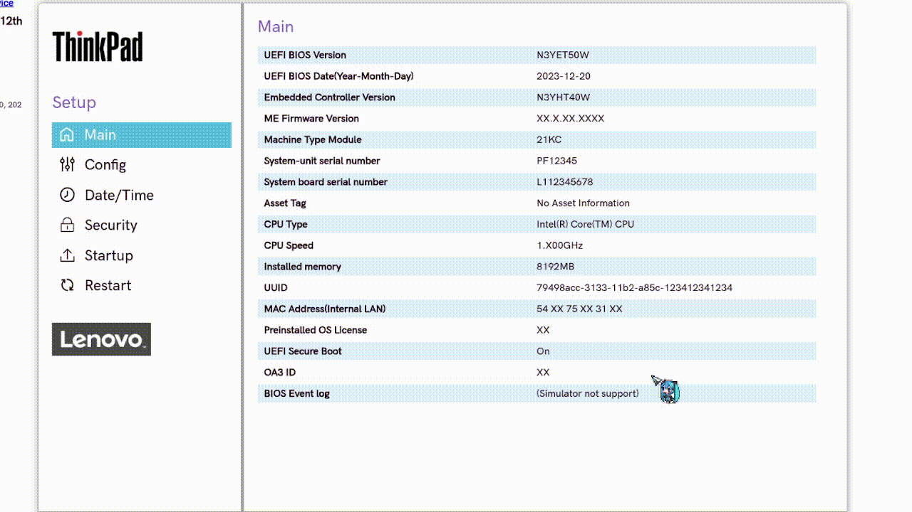

# Практика BIOS/UEFI в Lenovo BIOS Simulator Center

## Задание 1

*Main в Uefi Thinkpad'а*

## Задание 2

*Порядок загрузки в Startup -> boot*

## Задание 3

*Отключённый Secure boot*

## Задание 4

*Установка пароля супервизора*

## Задание 5

*Сброс на заводские настройки*

## Задание 6

*Управление встроенными устройствами*

## Задание 7

*Не нашлось*

## Задание 8

*Boot Menu без изменения постоянных настроек*

## Задание 9

*Просмотр системных логов*

## Задание 10

Задание (последовательно):

* Сбросить настройки на Factory Defaults (1 мин).
* Включить Secure Boot (1 мин).
* Установить Supervisor Password (2 мин).
* Поставить USB первым в порядке загрузки (2 мин).
* Сохранить и выйти (F10) (1 мин).
* Снова войти, проверить настройки, сбросить пароль и вернуть порядок загрузки (2 мин).
