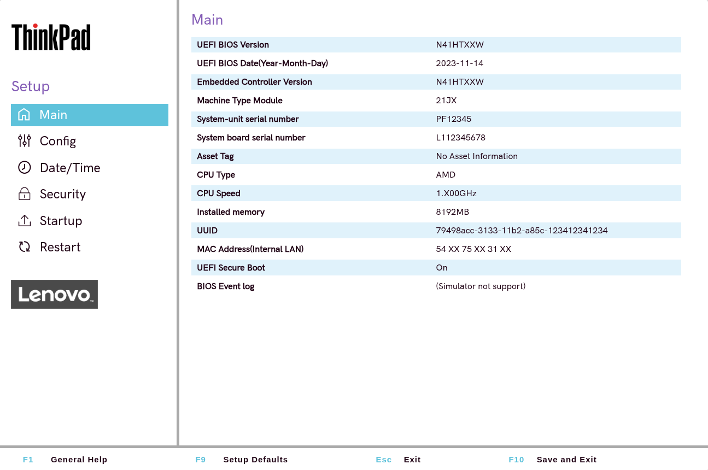
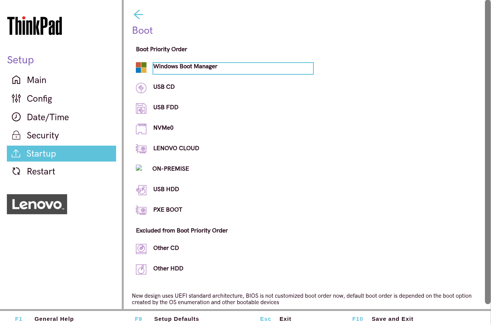
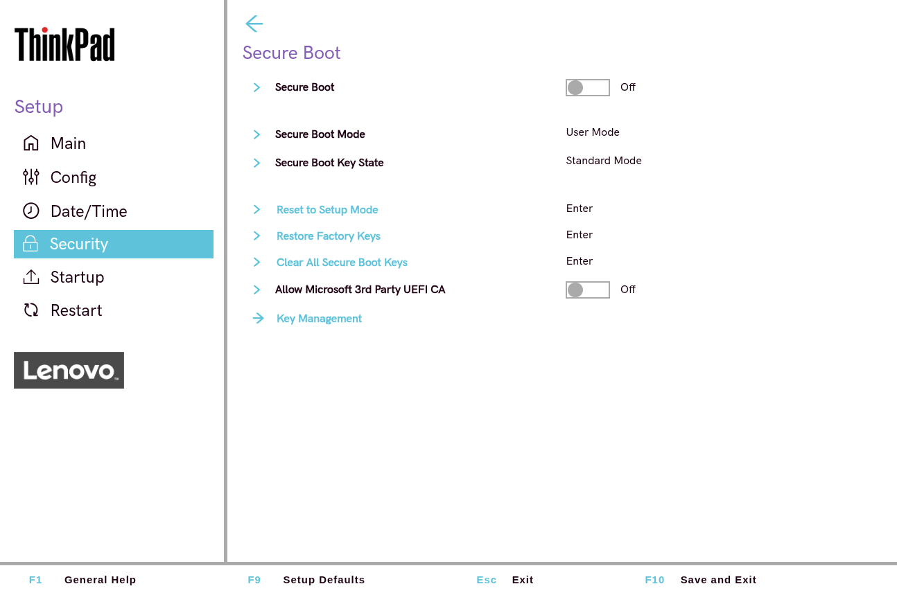
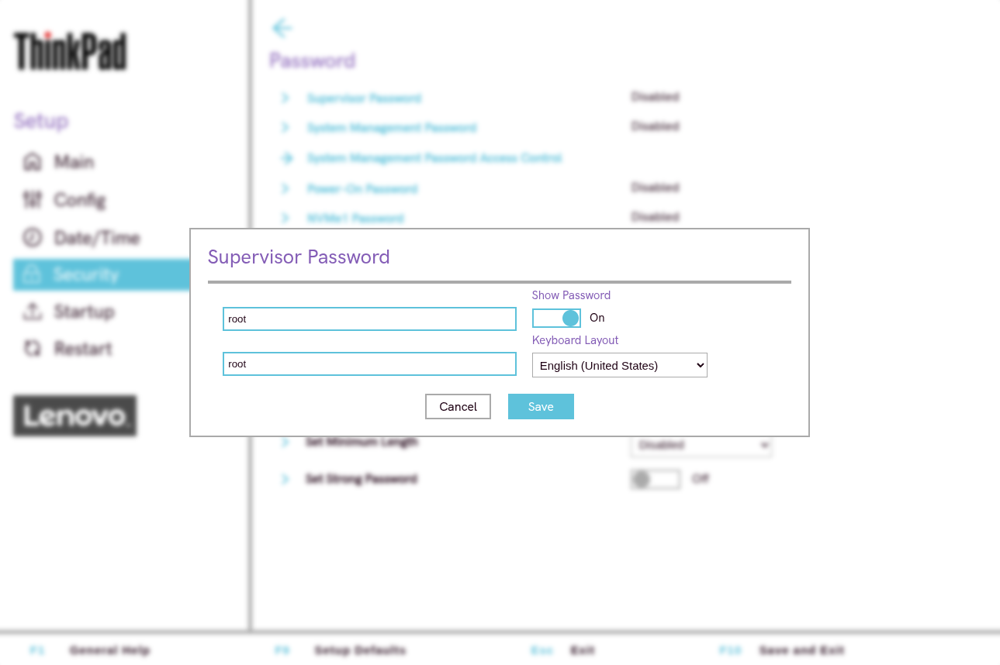
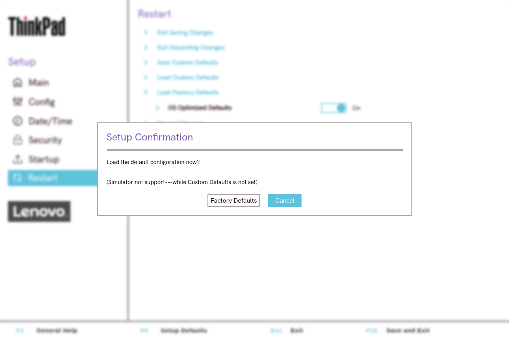
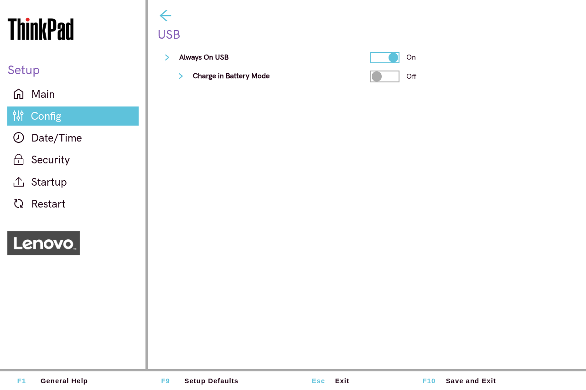
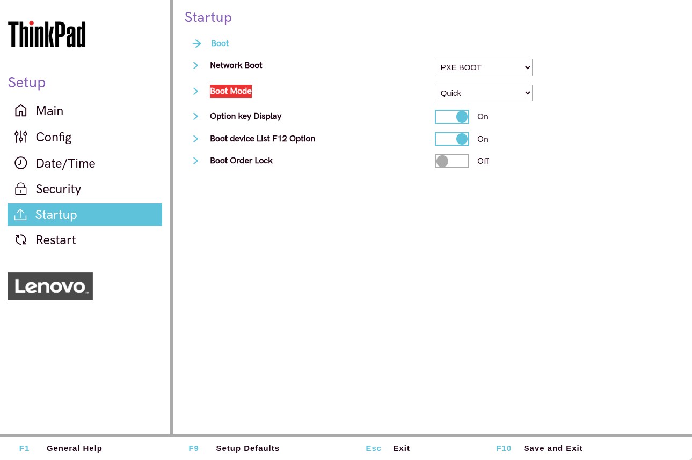
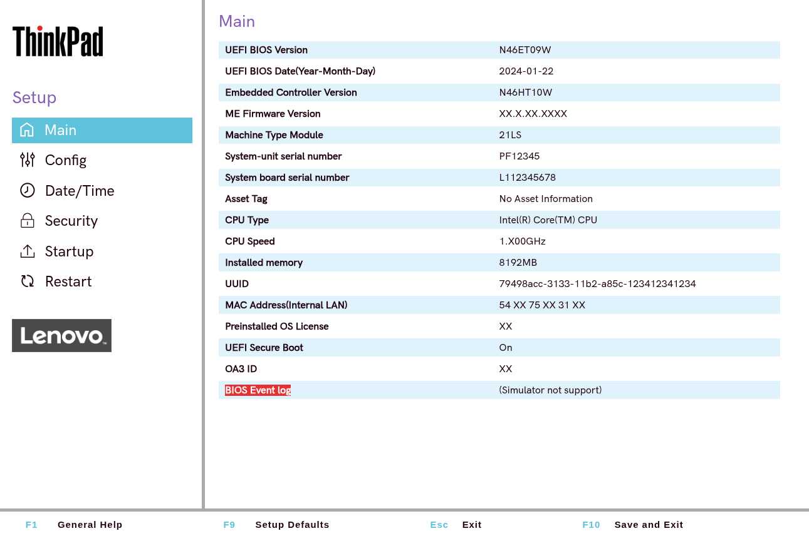

# Практика BIOS/UEFI в Lenovo BIOS Simulator Center

## Задание 1

*Main в Uefi Thinkpad'а*

## Задание 2

*Порядок загрузки в Startup -> boot*

## Задание 3

*Отключённый Secure boot*

## Задание 4

*Установка пароля супервизора*

## Задание 5

*Сброс на заводские настройки*

## Задание 6

*Управление встроенными устройствами*

## Задание 7
Не нашлось

## Задание 8

*Boot Menu без изменения постоянных настроек*

## Задание 9

*Просмотр системных логов*
